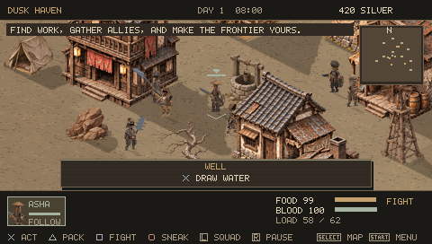
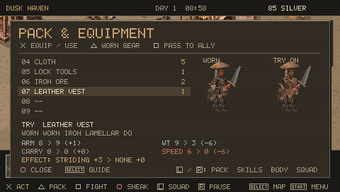
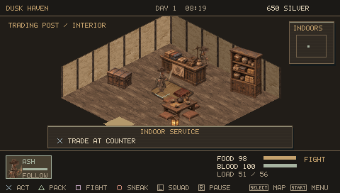
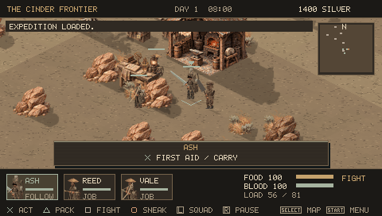

# Dustbound — PSP frontier survival RPG

An original isometric western–samurai squad RPG for PSP homebrew. Build a band of drifters, survive wounds and hunger, trade, steal, forge equipment and establish an outpost across a changing frontier. Inspired by Kenshi's systemic survival; this is a separate game using original code and original generated / procedural art, not a Kenshi port.

**Current milestone: 0.4.0, playable alpha.** A much broader sandbox than 0.1, with working versions of the requested core loops. It does not reproduce every Kenshi system or its scale. Physical PSP qualification remains outstanding.

[Download releases](https://github.com/andrewcirincione/Dustbound-PSP/releases) · [Field guide](docs/FIELD_GUIDE.md) · [Validation](docs/VALIDATION.md) · [Progress](docs/ROADMAP.md)



## A more readable frontier

0.4.0 adds a persistent target/action prompt, visible interaction reach, specialist NPC services, and equipment comparisons with WORN / TRY ON portraits, stat deltas and effects. Mining and lockpicking require staying within 1.15 world meters; automated miners walk into reach. Town spacing is four times greater while streets stay compact. The atlas has local and world views, player location, known towns, destination distance and travel orders.

The renderer now compiles 108 original painted sprites and 32 projected shadow masks. Calibrated building foundations use the same 2:1 projection as the terrain. Articulated painted torsos, limbs, headwear, boots and packs replace flat character shapes; weapon hands share a rigid grip throughout a strike. Textured indoor floors and walls match the exterior materials. PSP controller pictograms identify every input.

Walk through a door into a house, shop, inn, tower, smithy, workshop or depot. Counters trade, beds restore wounds, and workstations open forging, research or storage. Saves preserve the room and indoor position. Nineteen guide chapters explain the rules.




## What you can play

- A persistent 1536 × 1536 world, sixteen settlements, nine terrain regions, rivers/road fords, ruins, resource deposits, day/night, storms and environmental exposure.
- Up to eight controllable survivors; twenty skills improve through use. Followers, holding, mining, farming, medicine, smelting, cooking and depot hauling jobs.
- Character naming, five starts, three original ancestries, body build, eight skin tones, hairstyles, hair colors, beards and scars. Town barbers edit appearance.
- **2,016 generated gear variants:** 84 designs × 6 materials × 4 grades, plus base supplies and legacy equipment. Six visible slots. These are modular procedural variants, not 2,016 hand-drawn assets. Automated image hashes distinguish every variant at gameplay and portrait scale.
- Melee, polearms, bows, crossbows and frontier firearms. Windup/contact/recovery animations, directional swings, stagger, recoil, hit stop, blood/spark effects and procedural sound effects. Weapon reach, weight, skill and injured arms affect attacks.
- Six separate limb health values, armor coverage, bleeding, blood loss, knockout, permanent death, limb loss, prosthetics, first aid, carrying, paid doctors and sleep.
- NPC speech and service dialogue, finite market stocks, rotating daily gear, reputation/prosperity prices, recruitment, looting, theft, fencing, lockpicking, bounty and custody/bail/escape.
- Delivery, supply, hunt and relic contracts; persistent journal, faction ledger, town prosperity/ownership events and expedition legacy goals.
- Construction, farming/irrigation, storage, eight supply recipes, custom equipment forging and three research tiers.
- Six manual save slots plus autosave, checksums, backup files and v0.1/v0.2/v0.3 save migration. Nineteen contextual in-game guide chapters.



## Install on PSP

1. Use a PSP already configured to run homebrew. This repository does not install or modify firmware.
2. Download `Dustbound-0.4.0-PSP.zip` from the release and extract its `PSP` folder to the memory stick root.
3. The executable should be at `PSP/GAME/DUSTBOUND/EBOOT.PBP`. Launch it from **Game → Memory Stick**.
4. Back up existing `DUST_*.sav` files before upgrading. v0.1 through v0.3 saves are migrated when loaded; save the migrated game to a different slot first. Do not remove the memory stick during a save.

The single EBOOT includes its art, catalog and sounds. No network access or external assets are needed. Release packages exclude developer test saves and `DUST_QA` telemetry markers.

## Controls

| PSP input | Action |
|---|---|
| Analog /  | Move in screen direction; navigate menus |
|  | Interact, confirm, equip/use, buy/sell |
|  | Pack; press again for worn equipment |
|  | Fight/passive stance; transfer an item in pack |
|  | Sneak; close an overlay |
|  | Next squad member; previous inventory tab |
|  | Tactical pause; next inventory tab |
|  | Atlas; contextual guide inside an overlay |
|  | Expedition menu |

Menus stop simulation. Attacks are automatic when fighting is enabled and a hostile is in reach. Move to interrupt work or a travel route. In the forge,  chooses a design, material and grade;  on the final row crafts it. The guide explains each section.

## Build and test

```sh
bash scripts/build_native.sh
export PSPDEV=/path/to/pspdev
export PATH="$PSPDEV/bin:$PATH"
make -j2
python scripts/validate_pbp.py EBOOT.PBP
```

The native build exercises the same simulation and renderer. `make` uses the PSPDEV SDK to produce a real PSP PRX inside `EBOOT.PBP`; it is not a renamed desktop executable. The read-only GitHub Actions workflow runs native checks and compiles an EBOOT artifact using a pinned official PSPDEV toolchain.

```sh
# Generate test-only scenarios, then drive the EBOOT through PPSSPP:
mkdir -p build/emu
build/dustbound-native --fixtures build/emu
python scripts/emulator_v040.py /path/to/PPSSPPHeadless
python scripts/emulator_v040.py /path/to/PPSSPPHeadless --advanced
python scripts/emulator_interiors_v040.py /path/to/PPSSPPHeadless
# Verify all equipment drawings:
python scripts/audit_catalog.py
```

A desktop interactive build can define `USE_SDL` and link SDL2. Keyboard mapping: arrows, X/C/Z/V map to the four face-button pictograms; Q/E map to the shoulder keycaps; Enter and Tab map to the two system keycaps.

## Practical limits

The engine uses a fixed-size world state, capped actor/building/node pools and a software renderer designed for the 32 MB PSP model. It targets a 30 Hz display cadence at 333 MHz; emulator results do not establish physical hardware performance. This alpha has simplified town services, local navigation, faction simulation and job logistics. Interiors are single rooms with services, not multistorey NPC schedules or indoor combat. It has no slavery economy, multiple independent squads, diplomacy campaign or Kenshi asset/content parity. See the [Kenshi mechanics audit](docs/MECHANICS_AUDIT.md) and [iteration record](docs/ITERATION_LOG.md) for tested changes, simplifications and remaining work.

MIT license for the original source and included artwork. Art source atlases and the reproducible sprite packing script are included. PSPDEV and PPSSPP remain separate projects with their own licenses; neither is bundled in the game release.
