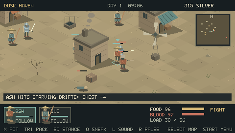
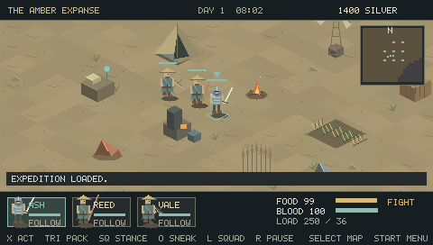

# Dustbound — PSP

An original isometric squad survival RPG inspired by Kenshi. **Version 0.1.0 is a playable alpha, not a complete Kenshi port or a feature-complete replacement.** All game code, world layout, characters and procedural visuals are included here. No Kenshi assets or code are required.

## Install

Extract `Dustbound-0.1.0-PSP.zip` to the root of your PSP memory stick. The final path must be:

```text
PSP/GAME/DUSTBOUND/EBOOT.PBP
```

Launch Dustbound from Game → Memory Stick on a homebrew-enabled PSP. The EBOOT is self-contained; no separate textures, fonts, music or data folders are required. PPSSPP can open the same EBOOT directly. Physical PSP hardware testing is still outstanding.

## Play

Start as a lone **Wanderer**, or choose **Caravan** for three survivors with better equipment. There is no main quest or victory screen: survive, improve, recruit, explore, trade, and establish a camp.

| Control | In the world |
|---|---|
| Analog stick or D-pad | Move in screen direction |
| X | Nearest interaction: talk, loot, gather, first aid, carry, workstations |
| Triangle | Inventory; L/R changes between pack, skills, body and squad |
| Square | Toggle fighting/passive stance |
| Circle | Toggle sneaking |
| L | Select next living squad member |
| R | Tactical pause |
| Select | World map; D-pad moves cursor, X sets a travel waypoint |
| Start | Build, craft, research, save, load, guide, speed and bounty payment |

Menus pause simulation. In inventory, X equips or uses an item and Square passes one item to a nearby ally. In Squad, left/right selects a member and X assigns a job. The active member can be moved directly; other followers trail behind. In combat, move close to a hostile while fighting stance is enabled; crossbows shoot from further away and consume bolts.

### A practical first day

1. Speak to **Ivo** near the inn in Dusk Haven. Recruiting costs 300 silver.
2. Search the abandoned crate east of the central well for a leather vest. Equip it in the pack screen; the world sprite and portrait change.
3. Mine iron south of town. Repeated gathering continues until you move, the deposit runs out, or your pack fills.
4. Trade with **Mara** near the market awning. Sell excess ore and buy food and dressings. Being overloaded slows you down.
5. Leave town with supplies. A campfire costs three timber; a bedroll shelter allows recovery. Build outside settlement boundaries.
6. Trade for iron bars to bootstrap a forge, then smelt your own ore. Add a farm, research bench and other structures. Camps attract periodic raids.

Characters eat carried rations automatically below 40 hunger. X near an injured ally uses your dressings; if you cannot treat an unconscious ally, X carries them. X while carrying puts them down. Blood loss can cause unconsciousness and death. There are mechanical replacement arms and legs for lost limbs, unlocked through research or bought from merchants.

## Implemented in 0.1.0

- Persistent 128 × 128 overworld: five settlements, five terrain regions, roads, ruins, fog of exploration and day/night lighting.
- Up to four squad members; follow, hold, mining, farming and field-medic jobs.
- Twenty use-based skills: athletics, strength, dexterity, melee, defence, toughness, dodge, martial arts, stealth, theft, lockpicking, medicine, labouring, farming, cooking, smithing, engineering, science, crossbows and perception.
- Real-time melee/ranged combat, tactical pause, six body locations, bleeding, unconsciousness, death, limb loss, prosthetic fitting, carrying and first aid.
- Twenty-nine item types, stack inventory, carrying weight and four visible equipment layers: weapon, torso, head and footwear.
- Merchants with finite daily stock, resale, paid recruitment, resource deposits, corpse looting, locked salvage and witnessed theft/reputation consequences.
- Eight camp structures: fire, shelter, farm, forge, research bench, palisade, ore depot and wind pump. Eight recipes and three research tiers.
- Hunger, fatigue, resting, traveling caravans, wildlife, hostile wanderers, guards, passive crop growth, resource regeneration and camp raids.
- Three manual save slots, an accessible autosave slot, versioned checksummed saves and a backup of the previous save.

## Honest scope and limits

This is a compact new implementation of several core ideas, with simplified systems. It does **not** include Kenshi's entire content, economy or AI. Slavery/capture/prisons, faction wars and town takeover, deep diplomacy, interiors, extensive character creation/races, equipment quality tiers, large squads and industrial production chains remain on the [roadmap](docs/ROADMAP.md). Crafting and construction are immediate resource transactions. Resource jobs are local; map travel uses local obstacle sliding rather than a full navigation mesh. Long routes may need manual correction. The depot stores iron ore only. Weather is visual. Audio is not implemented yet. Dead squad members currently retain their squad slot.

The build targets the PSP's native 480 × 272 display and a 30-frame/s presentation cadence. That target is not a claim of measured physical-hardware performance. See [validation](docs/VALIDATION.md) for exactly what was tested and how screenshots were obtained.

## Saves

Saves are stored alongside the EBOOT as `DUST_0.sav` through `DUST_3.sav`. Slot 0 is autosave; slots 1–3 are manual. Start → Load and left/right can select all four slots. Continue on the title screen loads slot 1. Save-and-title writes slot 1. A `.bak` file preserves the previous version of a slot; to restore it manually, back up your files and rename the desired backup to `.sav`. Do not mix saves from incompatible future formats.

## Build and test

PSPDEV v20261101 / GCC 15.2.0 was used for this release:

```sh
export PSPDEV=/path/to/pspdev
export PATH="$PSPDEV/bin:$PATH"
make -j2
```

Native simulation and sanitizer checks:

```sh
bash scripts/build_native.sh
cc -O1 -g -fsanitize=address,undefined -fno-omit-frame-pointer -std=gnu99 \
  -Isrc src/game.c tests/test_game.c -lm -o build/test-sanitize
ASAN_OPTIONS=detect_leaks=0 ./build/test-sanitize
```

The leak detector was disabled in the hosted test environment because ptrace prevents it from running. AddressSanitizer and UndefinedBehaviorSanitizer still run. See the validation document for emulator setup. `scripts/emulator_test.py` drives actual PSP controller inputs and reads the emulated display framebuffer, with state assertions for the played sequence. Late-game combat and camp scenes use explicitly labeled reproducible test saves.

The optional native development viewer is built from the same game and renderer with `-DUSE_SDL`, SDL2 and `-lm`. Its keyboard controls are arrows, X/C/Z/V for the four face buttons, Q/E for shoulders, Enter for Start, and Tab for Select. Native renders are development aids; delivered gameplay screenshots come from PPSSPP running the EBOOT.

## Development

Source and progress are tracked at [andrewcirincione/Dustbound-PSP](https://github.com/andrewcirincione/Dustbound-PSP). The release packages, validation evidence and [development roadmap](docs/ROADMAP.md) are versioned together. GitHub Actions runs the native tests and compiles the PSP executable with a pinned, checksummed toolchain. Release artifacts retain the exact emulator-tested EBOOT.




