# Dustbound — PSP frontier survival RPG

## 0.12.0 — An unquiet frontier

Eighty persistent encounter groups across sixteen situations: camps with usable beds, scavengers, refugees, hunters, smugglers, traders, patrols, raiders, beasts, pilgrims, wounded travelers, battlefields, marching armies, ambushes, salvage crews, prisoner convoys and duelists. Groups travel, rest, gather and clash off-screen. Their wounds, actual equipment, corpses and finite supplies survive leaving and returning. Prosthetics are uncommon, with stronger grades much rarer.

[Latest release](https://github.com/andrewcirincione/Dustbound-PSP/releases/tag/v0.12.0) · [Encounter details](docs/CONTENT_V120.md) · [PSP screenshots](docs/FEEDBACK_V120.md) · [Validation](docs/VALIDATION_V120.md)

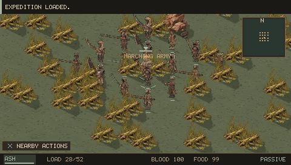

## 0.11.0 — Flesh and iron

Permanent limb loss, crawling, remaining-hand combat, five grades of mechanical arms and legs, regional replacement shops, Surgeon Venn in Dusk Haven, and physically lootable fitted parts on six wandering elites.

[Release notes](docs/RELEASE_NOTES.md) · [Limbs, shops and surgery](docs/CONTENT_V110.md) · [PSP screenshots](docs/FEEDBACK_V110.md) · [Validation](docs/VALIDATION_V110.md)

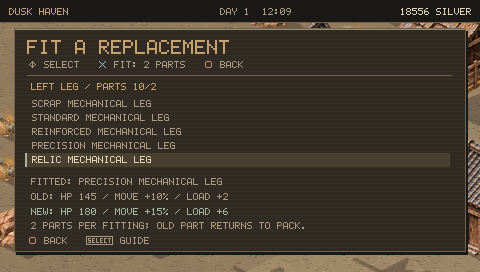

## 0.10.0 — Peoples, courts and personal arms

Five playable species with visible starting stats; different fortress, monastery, village, industrial and cannibal settlement plans; eighteen named rulers, champions and roaming elites with thirty-six personal equipment pieces; ninety-six additional cultural armor variants. Every one of the thirty-eight weapon types now has twelve distinct constructions across its twenty-four material/quality variants. Changes affect geometry and fittings as well as color, reach and handling.

[Release notes](docs/RELEASE_NOTES.md) · [Species and named owners](docs/CONTENT_V100.md) · [Current critiques](docs/DESIGN_REVIEW_V100.md) · [PSP screenshots](docs/FEEDBACK_V100.md) · [Validation](docs/VALIDATION_V100.md)

An original isometric western–samurai squad RPG for PSP homebrew. Build a band of drifters, survive wounds and hunger, trade, steal, forge equipment and establish an outpost across a changing frontier. Inspired by Kenshi's systemic survival; this is a separate game using original code and original generated / procedural art, not a Kenshi port.

**Current milestone: 0.12.0, persistent wilderness populations — playable alpha.** A much broader sandbox than 0.1, with working versions of the requested core loops. It does not reproduce every Kenshi system or its scale. Physical PSP qualification remains outstanding.

[Download releases](https://github.com/andrewcirincione/Dustbound-PSP/releases) · [Field guide](docs/FIELD_GUIDE.md) · [Validation](docs/VALIDATION.md) · [Progress](docs/ROADMAP.md)

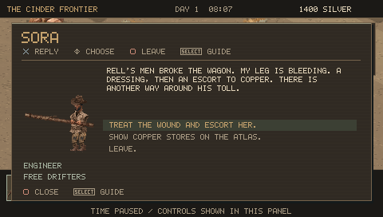

## 0.8.0: living frontier

An event director keeps eight incident slots renewing indefinitely. Caravans, raiders, relief appeals, caches, pilgrims, beasts, armies and warlords combine conditions, factions, destinations, strength tiers and equipment roles. Outcomes change trade and control; failed attacks can create relief appeals. Armies have up to sixteen members. Distant groups preserve their state while releasing actor slots.

Twenty-four additional specialist/signature equipment pieces and five encounter tiers make strong enemies rewarding. Hold L + Square (or Start > Squad > Choose opponent) to deliberately attack someone. Small allegiance marks and red opponent brackets provide feedback without persistent labels. The atlas uses corrected scale and clearer terrain, roads and town information.

In 0.9.0 incidents are encountered in the world; their old global journal tab is removed. [Review and remaining critiques](docs/DESIGN_REVIEW_V080.md) · [Validation scope](docs/VALIDATION_V080.md).

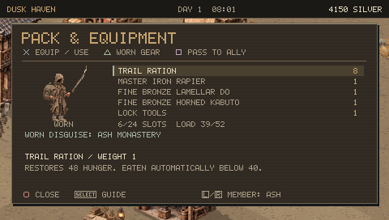
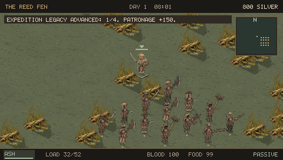

## 0.7.0: focused menus and regional consequences

Health & recovery combines injuries, treatment, mechanical repair and gear maintenance. Squad management combines immediate jobs, stances, travel groups and job priorities. L/R selects a member across character screens; D-pad Down opens Skills directly. Start retains Pause, Squad and World sections.

Inventory, selling, storage and loot show occupied rows with compact capacity counts. Comparisons emphasize changes, actual attack delay and strength requirements; Skills explains practical effects. Characters have clearer silhouettes and selected-character contrast. The atlas preserves roads at every zoom, distinguishes settlements and sites, and shows a dashed planned course or a solid active course.

Sneak beside a civilian and press Cross. Choose the item with the D-pad before stealing. The displayed odds account for the item, approach and visible witnesses.

Start > World > Journal & local conflicts, then L/R, opens three permanent regional disputes: Saltwatch's water concession, Black Mesa's toll camp and Pale Pass's winter refuge. Residents in these towns offer a local-conflict dialogue option. Visit the town with the listed supplies, or defeat the toll collectors, then commit the chosen agreement. Outcomes change supplies, prices, water/bed access and faction allegiance. Square locates the town or toll camp.

The compact HUD, in-range interaction prompts, analog-only movement and D-pad Up status toggle remain. New saves use format v7; the loader accepts previous formats through v6. See [release notes](docs/RELEASE_NOTES.md) and the current [validation limits](docs/VALIDATION_V070.md).

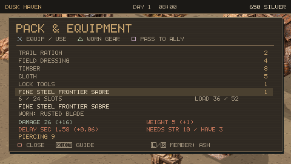
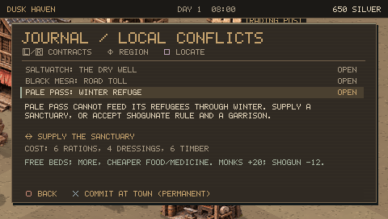

## 0.6.2: analog movement and D-pad menus

Only the analog stick moves the character, indoors and outdoors. In the world, D-pad Up toggles a live detailed status panel; Down opens Skills, Left opens worn equipment, and Right opens squad orders. Menu navigation continues to use the D-pad. Up does not pause time; R still provides tactical pause. The panel tracks the selected survivor and shows six limb health indicators, blood, food, fatigue, load and bleeding.

D-pad shortcuts preserve job queues and travel destinations. Only analog movement manually interrupts them. The desktop development build maps WASD to the stick and arrow keys to the D-pad.

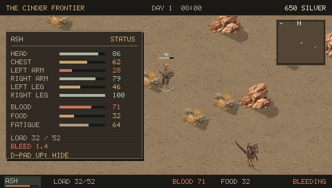

## 0.6.1: compact UI

The bottom HUD is one 20-pixel strip. Interaction prompts appear only within usable reach, and disappear in open space. Inventory, shop and loot lists use the full panel width with numerical equipment comparisons; the duplicate try-on characters are removed.

Start opens Pause, Squad and World tabs. L/R changes tabs; Circle returns to the menu from its subpages. Remote NPC service shortcuts have been removed: speak to the relevant NPC or use the workstation. **Skills: D-pad Down**, or **Start > Squad > Skills**.

**Stealing:** press Circle to sneak, approach a civilian and press Cross to open Pickpocket. It shows the item, success chance and consequences. Cross attempts the theft; Circle cancels. Owned salvage explicitly says STEAL. Pickpocketing now works near indoor residents as well. Named story/rescue characters keep their authored interaction outdoors.

This update was compiled for PSP and its layouts reviewed using static 480x272 native-rendered frames. No gameplay suites or emulator runs were performed for 0.6.1. Existing save format is unchanged.

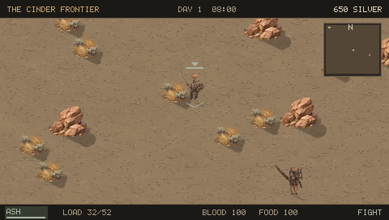
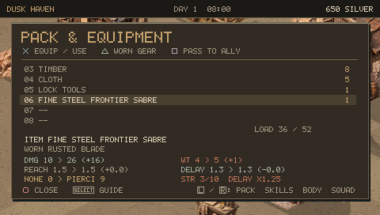

## 0.6.0: the Copper Road

An authored expedition gives the starting frontier a lasting conflict. Find wounded engineer Sora at the Salt Road wreck and escort her home. Repair the dry culvert, buy a truce, deliver Rell alive, or defeat him. Report to Nell at Copper stores. These outcomes persist in town allegiance, prices, stock, dialogue, convoy travel and retaliation. Eight landmarks add caches and route leads; the expedition ledger locates them on the atlas without replacing your travel order.

Construction now takes work, and owned fires/forges consume timber or coal. Four ordered job priorities and three expedition groups support separate travel leaders. Recovery distinguishes bandages, lasting trauma and mechanical repair. Captors carry fallen survivors to the chain yard; timed lock work, rescue and escape recognition offer a way back. Light cloth can be fitted beneath outer armor with distinct coverage and cut/blunt protection.

Projectiles move through the world, strike intervening actors and stop at structures. Defensive, ranged and hold-fire orders apply indoors and outdoors. Actual residents and nearby followers enter rooms; trespass requires a conscious witness. Markets open from 06:00 to 22:00. Complete dressed bodies retain their clothing and backpacks when prone.

Use Start > World for Copper Road and Camp Upkeep, and Start > Squad for Orders, Treatment and Armor Layers. Each has a contextual guide and controller icons. Read the [critical review](docs/DESIGN_REVIEW_V060.md) and [validation record](docs/VALIDATION.md) for implemented scope and limits. This is an original, bounded PSP survival RPG, not a complete reproduction of Kenshi.

Watch the persistent BLEEDING warning during travel. First aid stops bleeding; rest addresses lasting trauma. Dialogue and landmark work explain whether unconsciousness, stun, being carried or distance is preventing an action. Interrupted travel keeps its destination and shows ROUTE HELD with the cause; movement resumes after recovery. Actual blocked terrain and manual cancellation remain separate. Sora can receive another dressing during the escort if she needs more treatment; stay close and protect her on the road, or carry her at the cost of extra weight and slower travel.

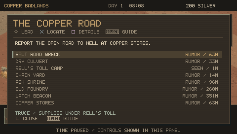
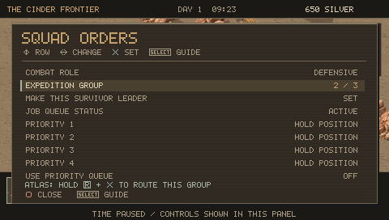

The sections below record the earlier systems retained by the rebuild.

## Reliable actions, recovery and camp work

0.5.2 audits all 27 screen types and the survival loop. Help returns to the exact selection; title/load cancellation returns to its origin; save-and-title asks for an explicit slot confirmation. Inventory operations preserve the selected stack and its stolen owner, including equipment, crafting, passing and salvage. Loot has numerical equipment comparison and full-stack transfer.

A rescue menu separates first aid, carrying and recovering gear. Nearby actions can be cycled with  held and . Workstations and beds require actual reach. Cooks fetch water and food, walk to campfires, and return output to depots; job status explains what they need. Shops show weapon/armor stat comparisons, recipes show held/needed materials, skills explain training and live effects, and recent messages remain accessible.

Toughness, perception and four production professions gain bounded practical benefits. See the [critical review](docs/DESIGN_REVIEW_V052.md) for the complete finding/change matrix, all-screen audit, balance rules and remaining limitations.

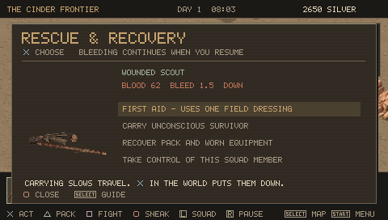
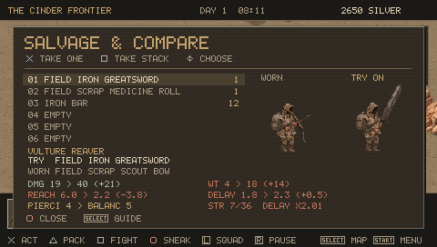

## Equipment fit and useful choices

0.5.1 corrects low/reversed backpacks, sword cutting-edge direction and left-facing shoulder/hand attachment. Per-design mounts place packs at the upper back, with separate shapes for flags, cloaks and scabbards. All twelve hats/hoods have smaller, aspect-correct silhouettes and individual brow anchors; necks meet collars. All 44 clothing designs receive native fit review and controller-driven equipment captures.

Garment-specific profiles replace catalog-order armor values. Plate offers protection at a weight, movement and stealth cost; robes remain light, and travel clothes favor weather, recovery or movement. Comparisons show actual movement percentages, stealth, carrying/weather bonuses and effects. The [balance table](evidence/v051-clothing-balance.csv) lists every design at the same grade.

Every trader now stocks four affordable bag types: travel pack, medicine roll, ore harness and bedroll pack. A dedicated BACKPACKS filter shows numerical comparisons. Packs offer different cargo-weight relief, carrying allowance, combat/stealth penalties and medical/recovery benefits. The comparison predicts actual loaded weight after an equipment swap; all use the existing 24-slot inventory.

The Journal can locate an active contract on the atlas without changing an existing travel order. Supply objectives show held/needed counts. A new contextual guide explains backpack choices. Existing v5 saves keep their item IDs and receive the new market stock once.

The [updated whole-game critique](docs/DESIGN_REVIEW_V051.md) separates these shipped fixes from the remaining gaps in world consequences, wilderness encounters, defeat/recovery, independent squads and outpost logistics.

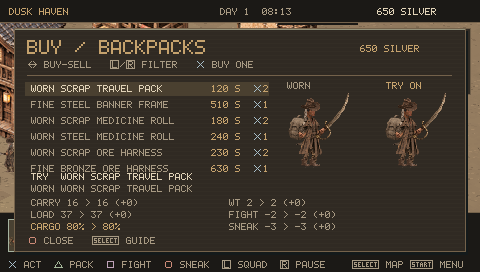
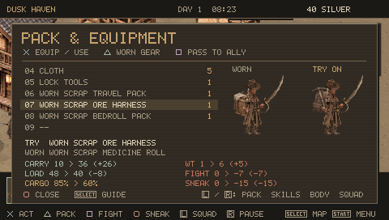

## Heavy steel and recognizable people

0.5.0 adds painted greatswords, railway mauls, crescent glaives and anchor cleavers. All 36 weapon families use weathered steel, leather and wood artwork. Strength and arm health affect heavy-weapon windup/recovery; the comparison shows the current handling penalty.

Profession and faction now shape NPC outfits, services, advice and behavior. Merchants and medics flee danger; guards fight and return to their posts. Medics have a separate approach beside town recovery areas. Regional weapon stock appears first in the weapon filter, giving different towns practical shopping specialties.

Contract guards offer one simulated day of escort (240 silver) or outpost watch (180). They fight and provide nearby first aid independently, keep their own gear, wait outside interiors and return home when the contract ends. Contracts save their remaining time and do not use a permanent squad slot.

The [whole-game design review](docs/DESIGN_REVIEW_V050.md) evaluates 34 areas, records what changed, and prioritizes what still falls short. Leader-driven world consequences, richer wilderness encounters, independent squads and deeper outpost logistics remain major gaps.

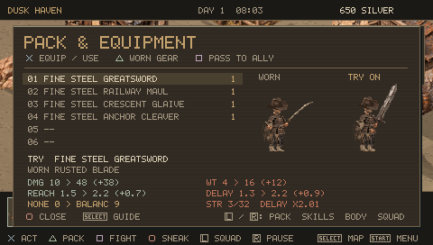
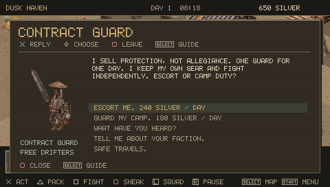

## A more readable frontier

0.4.0 adds a persistent target/action prompt, visible interaction reach, specialist NPC services, and equipment comparisons with WORN / TRY ON portraits, stat deltas and effects. Mining and lockpicking require staying within 1.15 world meters; automated miners walk into reach. Town spacing is four times greater while streets stay compact. The atlas has local and world views, player location, known towns, destination distance and travel orders.

The renderer now compiles 144 original painted sprites and 32 projected shadow masks. Calibrated building foundations use the same 2:1 projection as the terrain. Articulated painted torsos, limbs, headwear, boots and packs replace flat character shapes; weapon hands share a rigid grip throughout a strike. Textured indoor floors and walls match the exterior materials. PSP controller pictograms identify every input.

Walk through a door into a house, shop, inn, tower, smithy, workshop or depot. Counters trade, beds restore wounds, and workstations open forging, research or storage. Saves preserve the room and indoor position. Twenty guide chapters explain the rules.

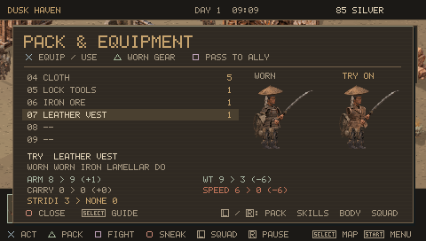
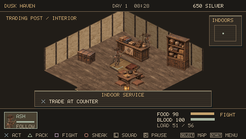

## What you can play

- A persistent 1536 × 1536 world, sixteen settlements, nine terrain regions, rivers/road fords, ruins, resource deposits, day/night, storms and environmental exposure.
- Up to eight controllable survivors; twenty skills improve through use. Followers, holding, mining, farming, medicine, smelting, cooking and depot hauling jobs.
- Character naming, five starts, three original ancestries, body build, eight skin tones, hairstyles, hair colors, beards and scars. Town barbers edit appearance.
- **2,112 generated gear variants:** 88 designs × 6 materials × 4 grades, plus base supplies and legacy equipment. Six visible slots. These are modular procedural variants, not 2,112 hand-drawn assets. Automated image hashes distinguish every variant at gameplay and portrait scale.
- Melee, polearms, bows, crossbows and frontier firearms. Windup/contact/recovery animations, directional swings, stagger, recoil, hit stop, procedural sound effects. Weapon reach, weight, skill and injured arms affect attacks.
- Six separate limb health values, armor coverage, bleeding, blood loss, knockout, permanent death, limb loss, prosthetics, first aid, carrying, paid doctors and sleep.
- NPC speech and service dialogue, finite market stocks, rotating daily gear, reputation/prosperity prices, recruitment, looting, theft, fencing, lockpicking, bounty and custody/bail/escape.
- Delivery, supply, hunt and relic contracts; persistent journal, faction ledger, town prosperity/ownership events and expedition legacy goals.
- Construction, farming/irrigation, storage, eight supply recipes, custom equipment forging and three research tiers.
- Six manual save slots plus autosave, checksums, backup files and v0.1 through v0.5.2 save compatibility. Twenty-five contextual in-game guide chapters.

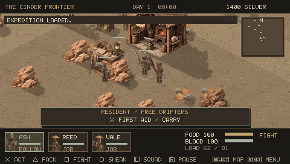

## Install on PSP

1. Use a PSP already configured to run homebrew. This repository does not install or modify firmware.
2. Download `Dustbound-0.6.2-PSP.zip` from the release and extract its `PSP` folder to the memory stick root.
3. The executable should be at `PSP/GAME/DUSTBOUND/EBOOT.PBP`. Launch it from **Game → Memory Stick**.
4. Back up existing `DUST_*.sav` files before upgrading. v0.1 through v0.5.2 saves are supported. Older formats migrate when loaded; save the migrated game to a different slot first. Keep a backup before using an older executable. Older-format migration refreshes regional markets, town NPC outfits and medic positions once; existing v5 saves receive the backpack supplement and the new frontier state once, preserving inventory and item IDs. New saves use version 6. Do not remove the memory stick during a save.

The single EBOOT includes its art, catalog and sounds. No network access or external assets are needed. Release packages exclude developer test saves and `DUST_QA` telemetry markers.

## Controls

| PSP input | Action |
|---|---|
| Analog stick | Move in screen direction |
| D-pad in the world | Up: status panel; Down: skills; Left: worn gear; Right: squad orders |
| D-pad in menus | Navigate menu entries and choices |
|  | Interact, confirm, equip/use, buy/sell |
|  | Pack; press again for worn equipment |
|  | Fight/passive stance; pass one item in pack; move a full stack in loot/storage |
|  | Sneak; close an overlay |
|  | Next squad member; previous inventory tab |
|  | Tactical pause; next inventory tab |
|  | Atlas; contextual guide inside an overlay |
|  | Pause / Squad / World tabs |

Menus stop simulation. Attacks are automatic when fighting is enabled and a hostile is in reach. Move to interrupt work or a travel route. In the forge,  chooses a design, material and grade;  on the final row crafts it. The guide explains each section.

## Build and test

```sh
bash scripts/build_native.sh
export PSPDEV=/path/to/pspdev
export PATH="$PSPDEV/bin:$PATH"
make -j2
python scripts/validate_pbp.py EBOOT.PBP
```

The native build exercises the same simulation and renderer. `make` uses the PSPDEV SDK to produce a real PSP PRX inside `EBOOT.PBP`; it is not a renamed desktop executable. GitHub Actions runs native checks and compiles with the pinned official PSPDEV v20261101 toolchain. It checks the executable against the controller-tested hash and the installer contents before publishing the alpha from `main`.

```sh
# Full release validation; requires PSPDEV, PPSSPPHeadless, Pillow and websockets:
bash scripts/validate_v060.sh /path/to/PPSSPPHeadless
# Package only after every controller run verifies the exact executable:
python3 scripts/package_v060.py
python3 scripts/verify_release_v060.py
```

To update documentation packages without replaying an unchanged executable, build the exact qualified EBOOT and use `python3 scripts/package_v060.py --from-qualified-evidence`. This mode checks the committed manifest, controller records and existing archives before reusing their evidence; it is not a new gameplay test. The [session handoff](docs/SESSION_HANDOFF.md) records project constraints, source ownership and remaining work.

A desktop interactive build can define `USE_SDL` and link SDL2. Keyboard mapping: arrows, X/C/Z/V map to the four face-button pictograms; Q/E map to the shoulder keycaps; Enter and Tab map to the two system keycaps.

## Practical limits

The engine uses a fixed-size world state, capped actor/building/node pools and a software renderer designed for the 32 MB PSP model. It targets a 30 Hz display cadence at 333 MHz; emulator results do not establish physical hardware performance. This alpha has simplified town services, local navigation, faction simulation and job logistics. Interiors support same-room combat and services, but remain single rooms without full resident schedules. Three expedition groups share the eight-survivor limit. Full slavery economics, recruited animals, disguises, electrical networks, destructible sieges and a diplomacy campaign remain absent. See the [0.6.0 review](docs/DESIGN_REVIEW_V060.md), [roadmap](docs/ROADMAP.md), and [historical mechanics audit](docs/MECHANICS_AUDIT.md) for tested changes, simplifications and remaining work.

MIT license for the original source and included artwork. Art source atlases and the reproducible sprite packing script are included. PSPDEV and PPSSPP remain separate projects with their own licenses; neither is bundled in the game release.
