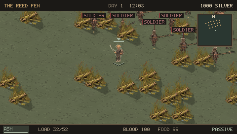

# Dustbound — PSP frontier survival RPG

## 0.17.0 — Three Banners

An original isometric western–samurai survival RPG for PSP homebrew, inspired by Kenshi. Build a squad, survive injuries and hunger, trade, steal, craft equipment and establish a camp among independent factions and wandering groups.

[Download 0.17.0](https://github.com/andrewcirincione/Dustbound-PSP/releases/tag/v0.17.0) · [Three Banners design](docs/FRONTIER_WAR.md) · [Field guide](docs/FIELD_GUIDE.md)

Nineteen settlements include Brass Junction, Vermilion Keep and Cinder Abbey. The Compact, Shogunate and Ash Monastery send armies against one another. Captured cities can have guarded labor yards, and nearby residents pass on news of actual raids and victories.

There is no map or group auto-travel. Cross on the map places a reference pin; walk with the analog stick. Squad followers, work jobs and NPC movement remain part of the simulation.

Starving bandits carry poor weapons and wear incomplete clothing. Soldiers wear coordinated armor and move in three-wide formations. Elite duelists wear complete superior equipment. Nearby labels show a broad role in faction colors, with a red **!** for hostility. Enemy combat bars show knockout reserve from head, chest and blood. Nearby characters do not expose skill values or encounter tiers. Start > World > Factions shows the color key, reputation and wanted standing.

The world activity ledger records where and when you actually saw a group. A report can be located on the map, but does not track the group after it leaves. Councils show named claimants and the price policy each would implement. Beds beside NPCs now perform the selected rest action reliably. Characters retain a visible silhouette through foreground scenery, successful autosaves are silent, and routine skill gains cannot fill an existing message queue.

Fighting now has clearer windups, outlined knockout bars and staggered AI melee attacks. Passive stance cancels your attack so you can retreat. Six roadside rock passes offer cover and alternate routes; free wayfarer beds provide finite supplies and recovery stops. Emergency dressings can consume cloth or worn rags, and friendly medics can approach and stabilize you when safe. Government changes reposition surviving guards, civilians and relief medics.

Weapon handling now changes the actual strike speed. Relaxed carry and combat guards blend smoothly; fists, bows, firearms, thrusting weapons and heavy swings have distinct motion. Rigid grips prevent overstretched arms, walking follows distance, and combat labels leave raised weapons visible.

## The wider game

- Five playable species, distinct settlement cultures, eighteen named leaders and elites, and personal equipment.
- Eighty persistent wilderness groups across sixteen encounter types, from refugee camps with usable beds to armies, convoys and ambushes.
- Hunters pursue real prey; survivors use medicine and carry casualties; camps seek finite supplies; refugees can settle; armies reinforce, supply and assault settlements.
- Six body regions, permanent limb loss, crawling, two-handed weapon penalties, five prosthetic grades, shops and a surgeon.
- Weapons with different shapes, reach and handling; layered clothing, backpacks, crafting requirements and direct equipment comparisons.
- Faction reputation, crimes, imprisonment, rescue, recruiting, hired guards, job queues, outpost work and succession after ruler deaths.

[Living world](docs/CONTENT_V130.md) · [Encounters](docs/CONTENT_V120.md) · [Limbs](docs/CONTENT_V110.md) · [Species and equipment](docs/CONTENT_V100.md)

## Install

Extract `Dustbound-0.17.0-PSP.zip` to the memory-stick root, or replace `PSP/GAME/DUSTBOUND/EBOOT.PBP`. A PSP capable of running homebrew, or PPSSPP, is required. Keep your saves before upgrading. Save format v17 reads prior expeditions and adds the new capitals and armies. Existing equipment, training and town control carry over.

## Controls

| Input | Action |
|---|---|
| Analog stick | Walk; interrupt work |
| Cross | Nearby actions; confirm menu choice |
| Circle | Back |
| Triangle | Inventory |
| Select | Atlas in the world; contextual guide in menus |
| Start | Pause menu |
| D-pad | Information shortcuts / menu selection; never walking |
| R in the world | Pause/resume simulation and queued actions |
| L + Square | Choose an opponent |
| Cross in the atlas | Place a manual reference pin |

The pause menu has Pause, Squad and World tabs. Factions and World activity are in World. Menus stop simulation. Combat and assigned jobs retain their own behavior; map pins never issue movement.

## Build and verify

With PSPDEV available, run `make -j2`, then `python3 scripts/validate_pbp.py EBOOT.PBP`. The PSP build uses PSPDEV v20261101.

Run the regression gates from `scripts/validate_v080.sh` through `scripts/validate_v160.sh` listed in `.github/workflows/build.yml`. Run `bash scripts/validate_v170.sh path/to/v16.sav` to verify war behavior and older saves. Pass that same old save to `python3 scripts/emulator_v170.py /path/to/PPSSPPHeadless path/to/v16.sav` to check the compiled EBOOT using controller input (Python dependencies: Pillow and websockets).

This remains a playable alpha. PPSSPP testing does not qualify physical PSP performance, and the focused controller scenarios are not a naturally played full campaign. Offline battles use a simplified model. See the current validation record for exact scope.

MIT license for original source and included artwork. PSPDEV and PPSSPP are separate projects and are not bundled with the release.
