# Dustbound 0.9.0 — PSP screenshot review

All 31 images are actual final-EBOOT frames captured in PPSSPP at 480×272. Overview sheets add labels and margins only; individual captures retain the original pixels.

Player feedback is most useful on inventory readability, the compact action drawer, atlas navigation, trade information, rescue choices and whether the top log remains unobtrusive. [Current critiques](DESIGN_REVIEW_V090.md) and [validation limits](VALIDATION_V090.md).

## Character

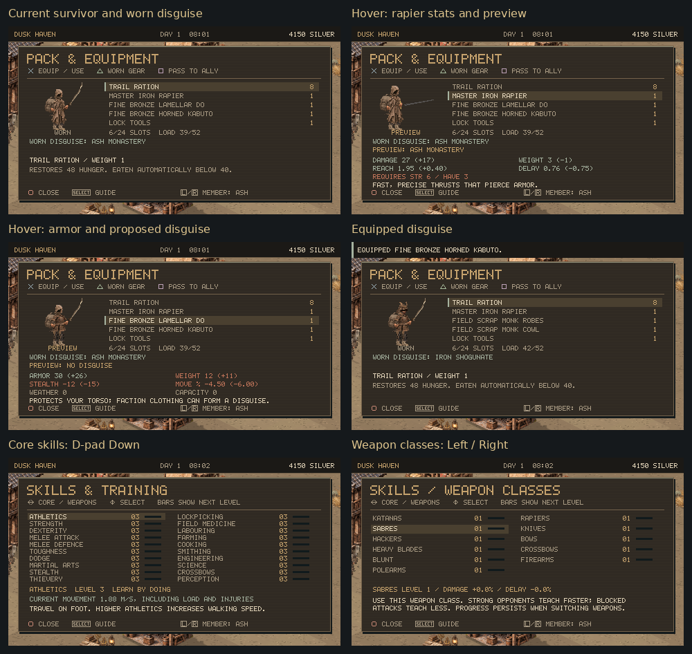

## World

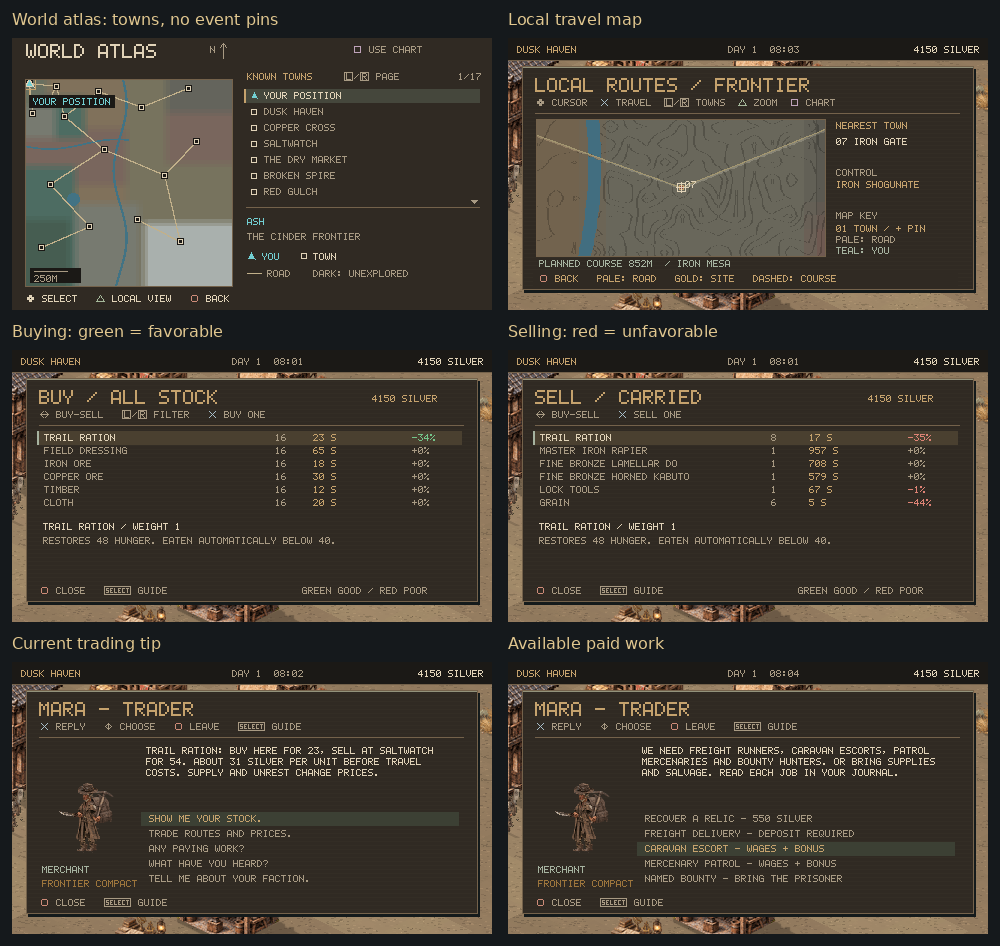

## Actions

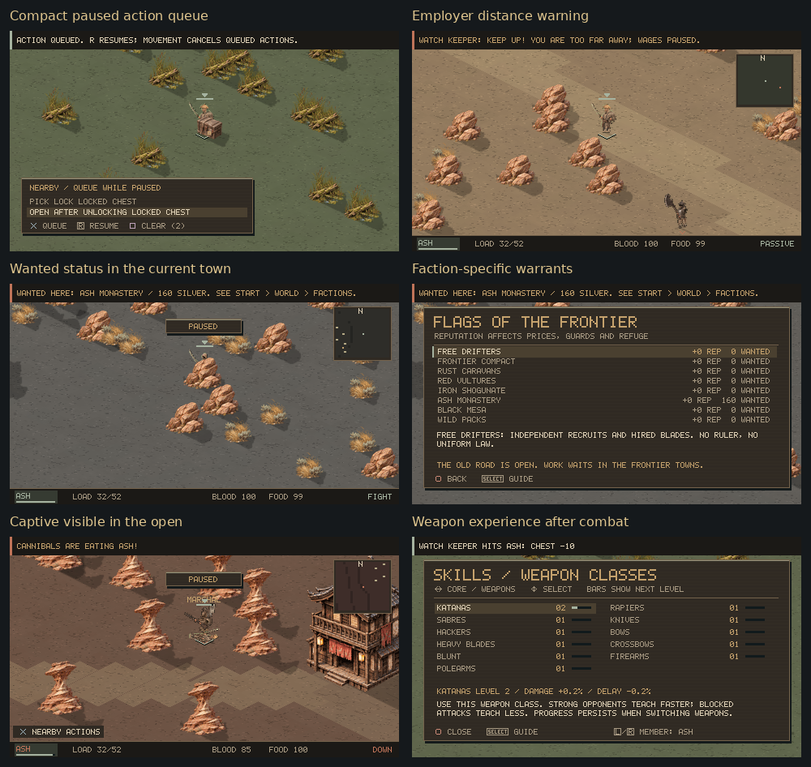

## Rescue

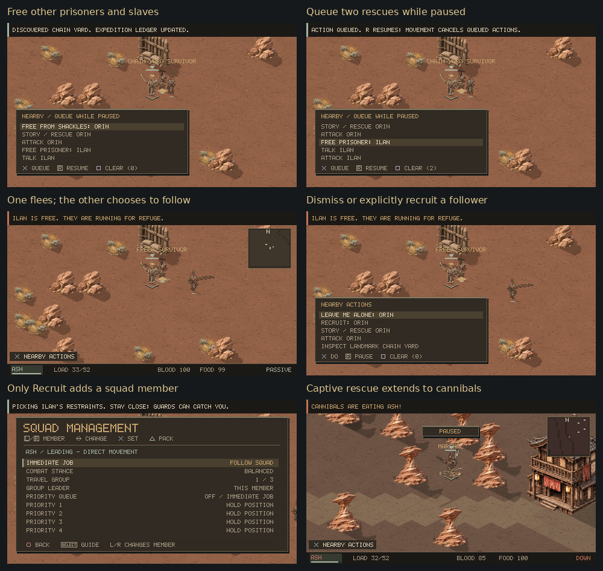

## Individual captures

### Title

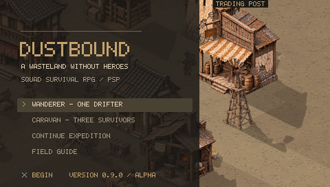

### Inventory Worn

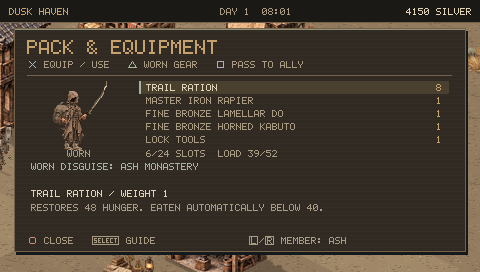

### Inventory Rapier

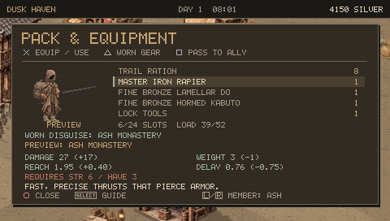

### Inventory Armor

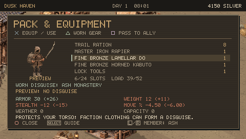

### Inventory Disguise

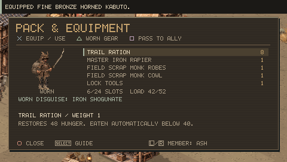

### Skills

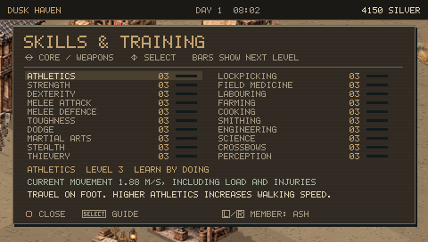

### Weapon Classes

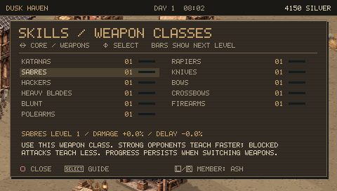

### Atlas

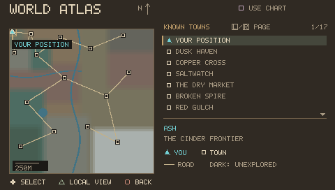

### Atlas Page

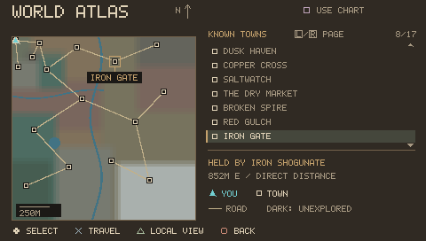

### Local Map

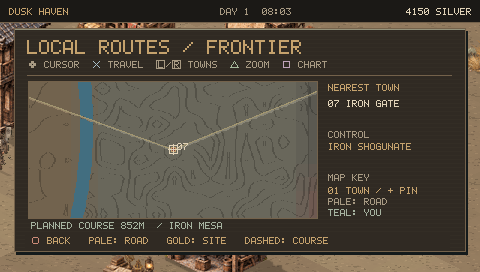

### Merchant

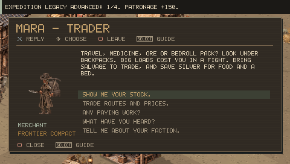

### Buy Prices

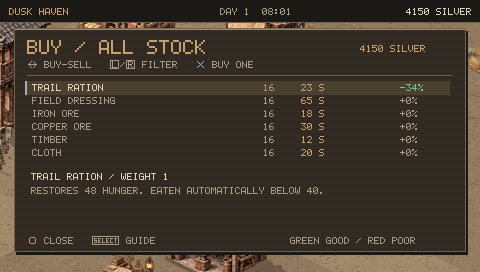

### Sell Prices

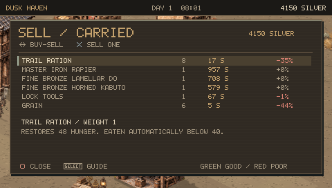

### Trading Tip

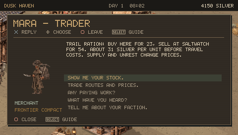

### Work

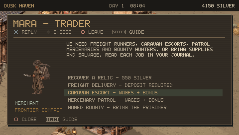

### Job Accepted

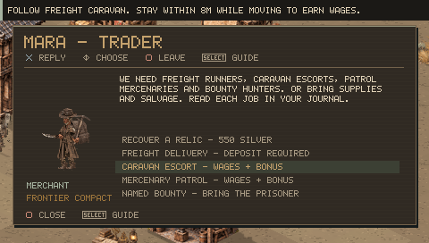

### Actions

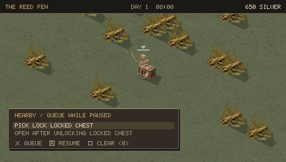

### Queued Actions

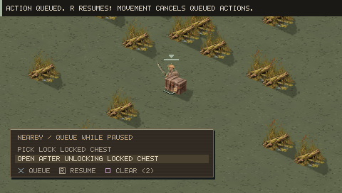

### Lock Opened

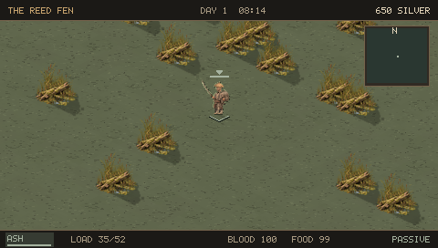

### Employer Warning

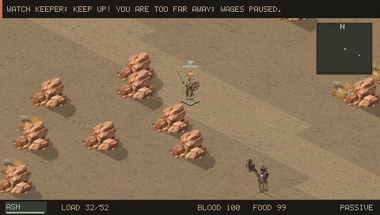

### Wanted

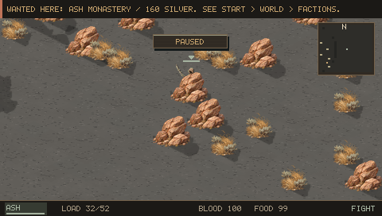

### Faction Warrants

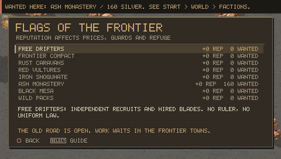

### Cannibal Capture

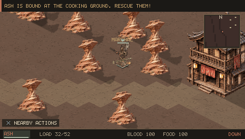

### Cannibal Danger

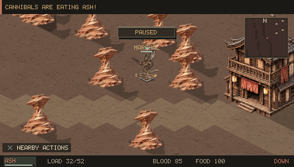

### Combat Training

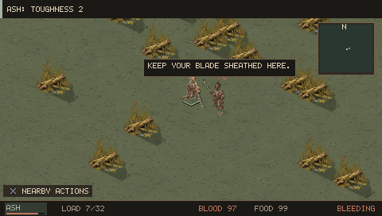

### Trained Weapon

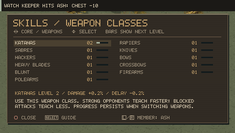

### Free Prisoners

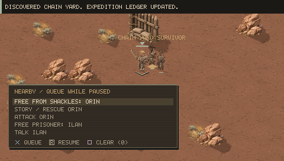

### Queued Rescues

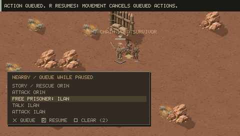

### Freed Escape

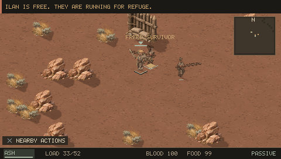

### Freed Options

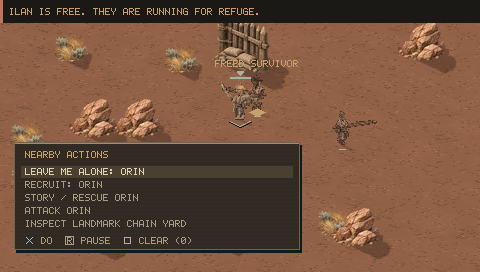

### Explicit Recruitment

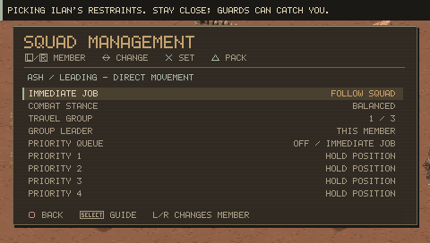
