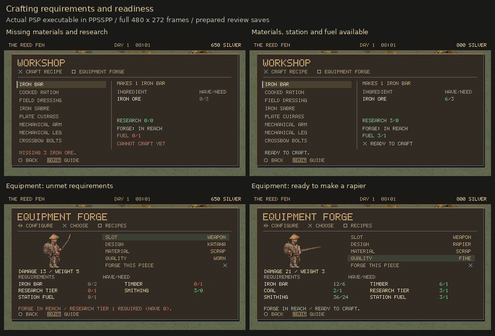
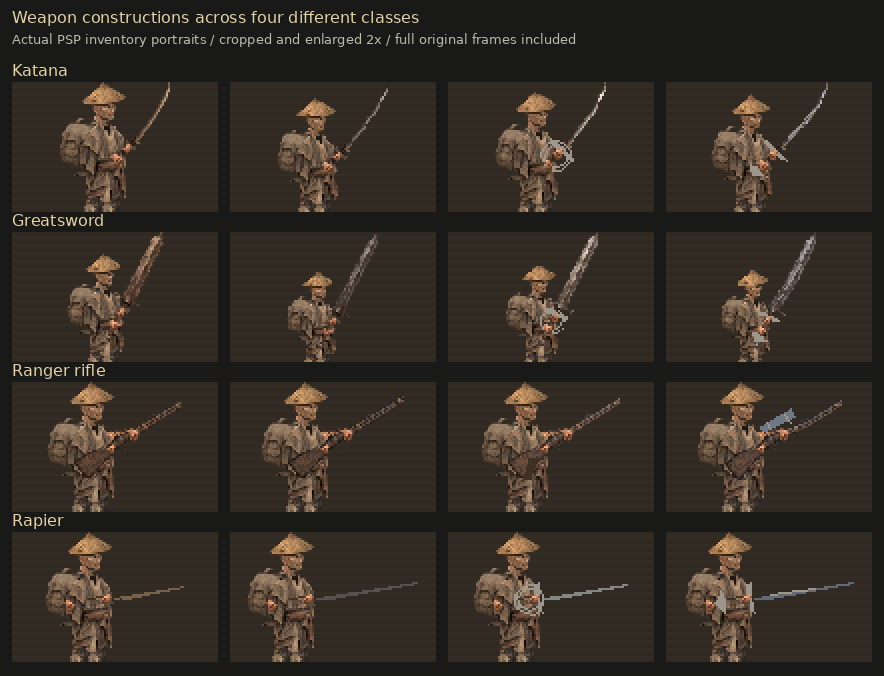
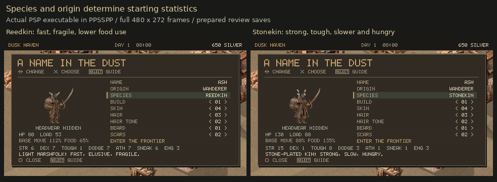
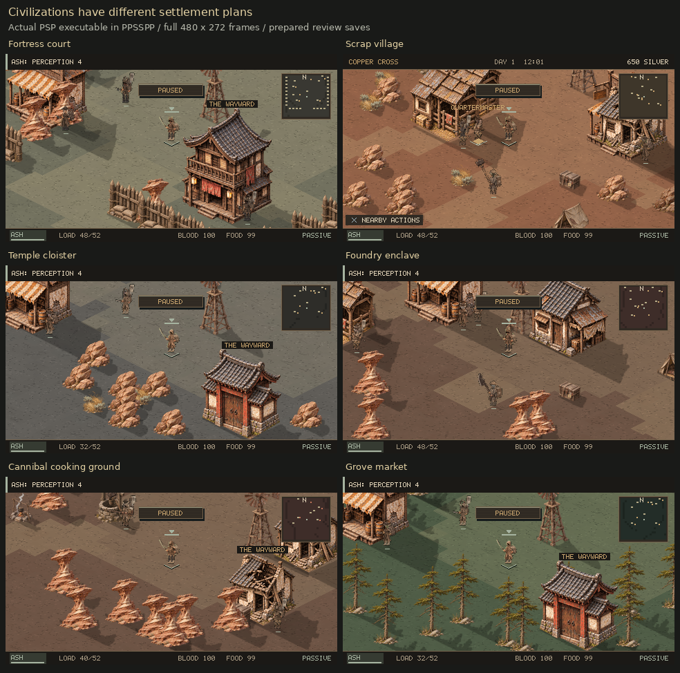
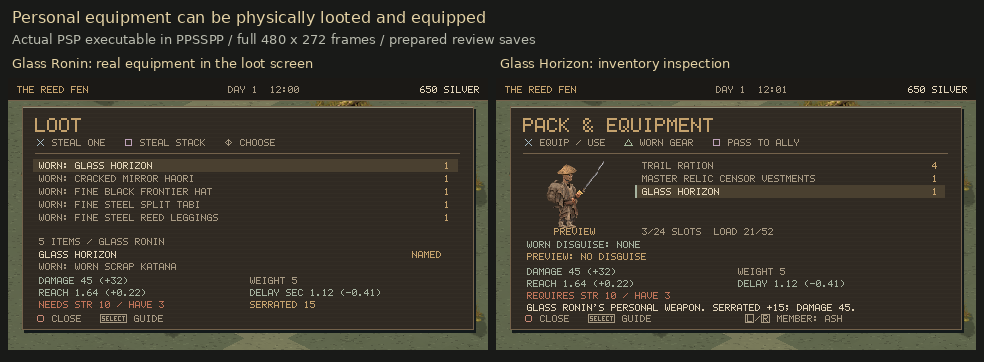

# 0.10.0 screenshot review

These comparisons use completed frames from the actual PSP executable running in PPSSPP, with ordinary prepared saves and controller input. Full frames are retained at 480×272. The weapon portrait comparison is explicitly cropped/enlarged; it is not a concept image. The separate 38 weapon sheets below use the same production renderer in a native test.

## Crafting

Review the legibility of owned/required ratios and the green-enough/red-short colors, fuel and workstation information, and switching between recipes and equipment with Square.

[Alternative cooking ingredients](../evidence/v100-psp-cooking-alternatives.png) · [Station out of range](../evidence/v100-psp-crafting-away.png) · [After forging](../evidence/v100-psp-forged-rapier.png)

## Weapon constructions

Review whether the differences are readable at game scale and whether grips and fittings look attached. These are four samples per displayed class; every type has 12 constructions and two quality finishes per construction.

## Species

Review whether starting strengths/tradeoffs are understandable and the species are visually distinguishable. Species share the articulated rig; unique anatomy and movement remain a critique.

[Lowlander](../evidence/v100-psp-species-0.png) · [Ashlander](../evidence/v100-psp-species-1.png) · [Clockwork](../evidence/v100-psp-species-2.png)

## Civilization layouts

Review the court/village/monastery distinction and whether the world reads clearly without adding large UI labels. Screens show portions of towns, not overhead plans of their entire layout.

## Named equipment

Review the equipment's appearance and readable inventory details. The named actor physically carries the items; these are not duplicate reward cards.

## Full weapon sheets

Native production-renderer views at 3×, 12 constructions on each sheet. These are distinct from PSP frame captures above. The [content list](CONTENT_V100.md) names all 38 types in the same order as sheets 00–37.

| Types | Sheets |
|---|---|
| Katana / wakizashi / nodachi / tanto | [00](../evidence/v100-weapons-00.png) · [01](../evidence/v100-weapons-01.png) · [02](../evidence/v100-weapons-02.png) · [03](../evidence/v100-weapons-03.png) |
| Naginata / yari / nagamaki / kusarigama | [04](../evidence/v100-weapons-04.png) · [05](../evidence/v100-weapons-05.png) · [06](../evidence/v100-weapons-06.png) · [07](../evidence/v100-weapons-07.png) |
| Frontier sabre / bowie knife / trail machete / butcher cleaver | [08](../evidence/v100-weapons-08.png) · [09](../evidence/v100-weapons-09.png) · [10](../evidence/v100-weapons-10.png) · [11](../evidence/v100-weapons-11.png) |
| War pick / boarding axe / kanabo / tetsubo | [12](../evidence/v100-weapons-12.png) · [13](../evidence/v100-weapons-13.png) · [14](../evidence/v100-weapons-14.png) · [15](../evidence/v100-weapons-15.png) |
| Quarterstaff / hook blade / ring sabre / broken falchion | [16](../evidence/v100-weapons-16.png) · [17](../evidence/v100-weapons-17.png) · [18](../evidence/v100-weapons-18.png) · [19](../evidence/v100-weapons-19.png) |
| Horse cutter / saw sword / twin sickle / spiked club | [20](../evidence/v100-weapons-20.png) · [21](../evidence/v100-weapons-21.png) · [22](../evidence/v100-weapons-22.png) · [23](../evidence/v100-weapons-23.png) |
| Scout bow / repeater bow / heavy arbalest / hand crossbow | [24](../evidence/v100-weapons-24.png) · [25](../evidence/v100-weapons-25.png) · [26](../evidence/v100-weapons-26.png) · [27](../evidence/v100-weapons-27.png) |
| Longbow / ranger rifle / dragoon pistol / scattergun | [28](../evidence/v100-weapons-28.png) · [29](../evidence/v100-weapons-29.png) · [30](../evidence/v100-weapons-30.png) · [31](../evidence/v100-weapons-31.png) |
| Greatsword / railway maul / crescent glaive / anchor cleaver | [32](../evidence/v100-weapons-32.png) · [33](../evidence/v100-weapons-33.png) · [34](../evidence/v100-weapons-34.png) · [35](../evidence/v100-weapons-35.png) |
| Scimitar / rapier | [36](../evidence/v100-weapons-36.png) · [37](../evidence/v100-weapons-37.png) |

[Validation and limitations](VALIDATION_V100.md) · [Current critiques](DESIGN_REVIEW_V100.md)
