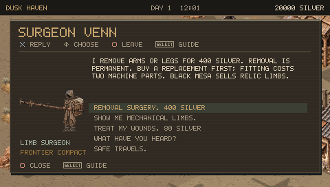
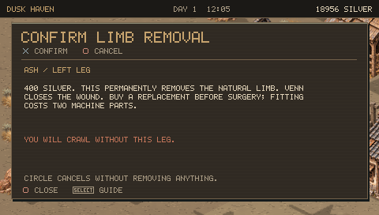
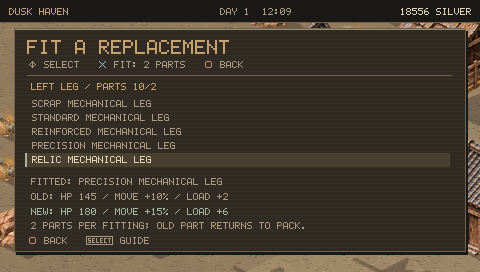
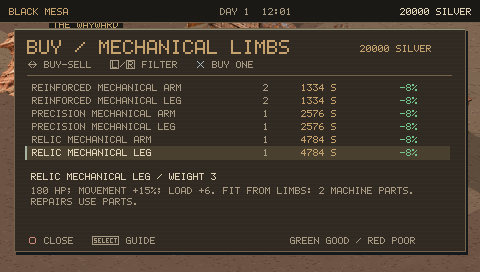
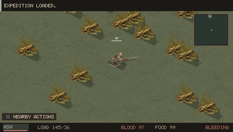
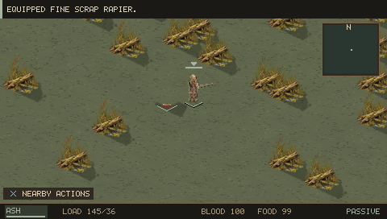
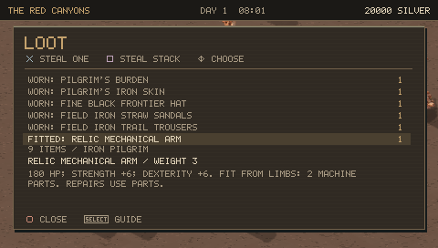
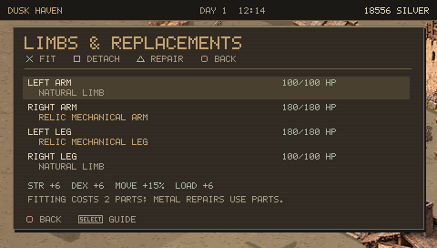
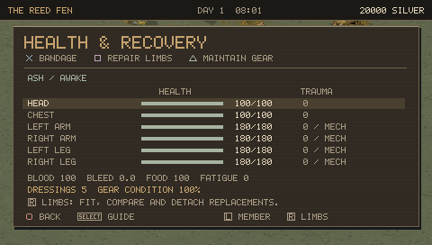
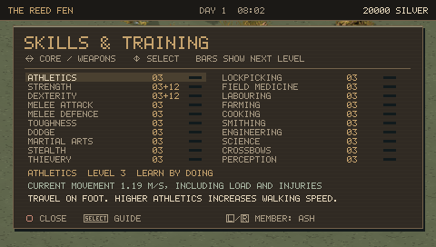

# 0.11.0 PSP screenshot review

These are completed 480×272 framebuffers from the published EBOOT running in PPSSPP, reached using ordinary controls and prepared saves. See [validation](VALIDATION_V110.md) for coverage and limitations.

## Buy, remove and fit

Venn's dialogue explains the permanent consequence and costs. Surgery requires an explicit confirmation. Comparison screens show all five compatible grades with old/new HP and bonuses. Black Mesa carries Relic stock at the actual local price.

## Anatomy and real equipment

The crawl pose has a horizontal torso, grounded hands and a dragging remaining leg; both missing legs remain absent. The weapon moves to the surviving hand. Fitted wanderer equipment appears as a separate actual loot entry and disappears when taken.

## Persistence and stats

The save/reload frame retains the fitted Relic arm and leg. Health shows the correct 180-HP mechanical limits, while Skills distinguishes learned values from equipment bonuses.

Remaining critiques: silhouettes are necessarily small at PSP resolution, and the five grades share a mechanical anatomy with different tints. The prepared tests do not establish how often limb loss occurs across an ordinary campaign or whether top-tier prices are balanced over many hours. Physical PSP performance remains to be measured.
