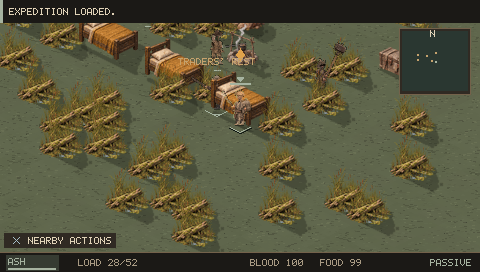
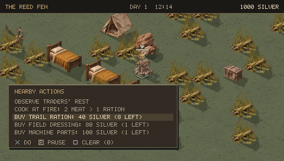
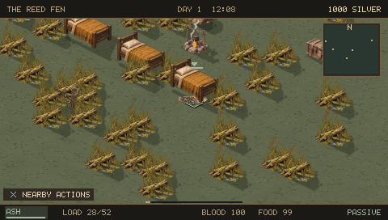
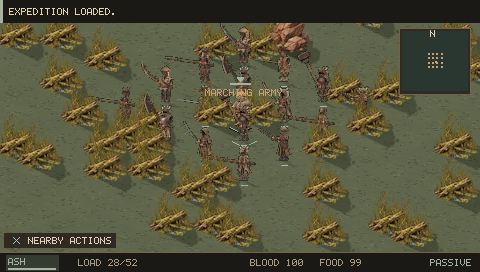
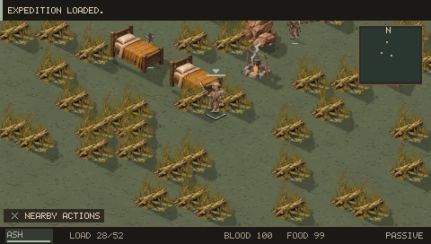
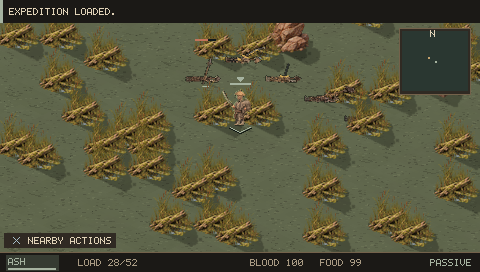
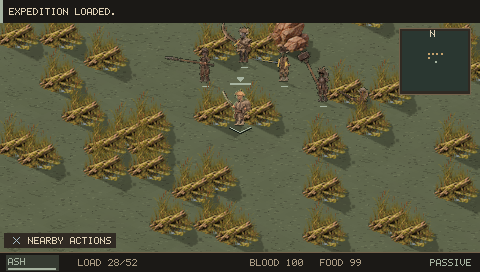
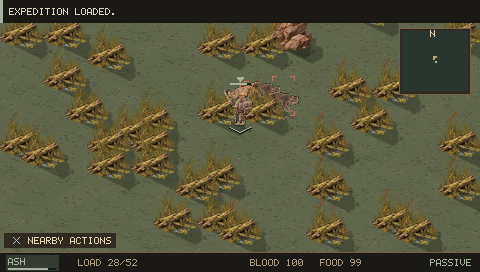
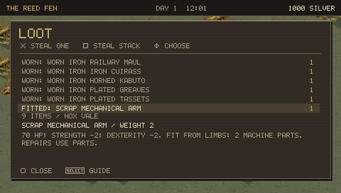
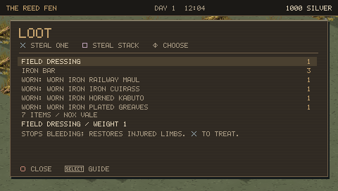

# 0.12.0 PSP screenshot review

Completed framebuffers from the final PSP executable, reached with ordinary controls. Most encounter scenes use prepared saves on the same ground for comparison; they are not claims of a naturally played campaign. The [validation record](VALIDATION_V120.md) describes the checks.

## Camps and larger groups

Camps now have a separate tent, fire, physical beds and supplies. NPCs occupy the camp and leave to forage; the player's free bed is available when safe. Armies have an actual 12–16-member roster.

## Different situations

These situations contain actual actors with different roles, injuries and equipment. Hostile groups can attack, prisoners use the rescue system, and fallen actors keep their loot.

## Rare fitted loot

This owner received a Scrap arm from the ordinary population roll. The item is present before taking it and absent after save/reload. Nearby camp traders sell supplies, not an abundant stock of replacements.

Remaining critiques: camp architecture shares the existing prop set; different camp purposes are mainly expressed through residents, behavior, hostility and supplies. Off-screen combat is coarse, large groups can wait for the bounded live actor pool, and broad political strategy remains outside this update. A multi-hour campaign and physical PSP performance pass remain open.
