# 0.13.0 PSP review and remaining critiques

Final executable frames reached with controller input. Camps, rescue, councils and limb comparisons use prepared ordinary saves. The starting journey uses normal character creation. See [validation](VALIDATION_V130.md) for the exact distinction.

## Decisions visible to the player

The fresh journey meets a hostile group outside Dusk Haven. Prepared ambushers disappear from both the world and minimap outside detection range, then reveal themselves and attack. The rescue check verifies actual medicine and carry state, including reloading.

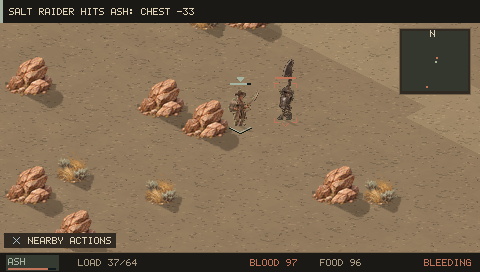
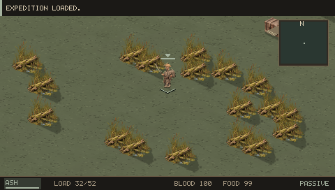
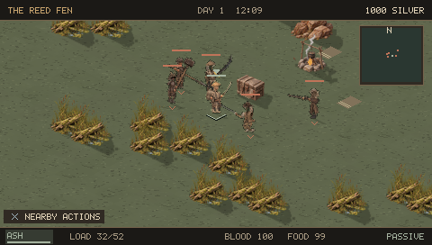
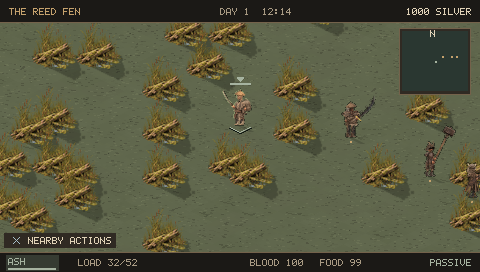

## Camp readability

Improvised cloth bedrolls and scattered arrangements distinguish refugees/hunters from ordered trader beds. Clearing nearby decorative vegetation makes the usable objects easier to see. The same tent/fire atlas remains a visible limitation; further distinct faction structures would improve identity.

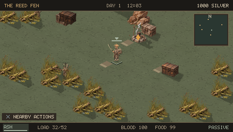
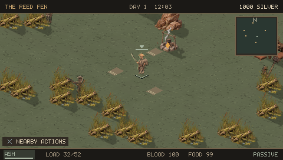
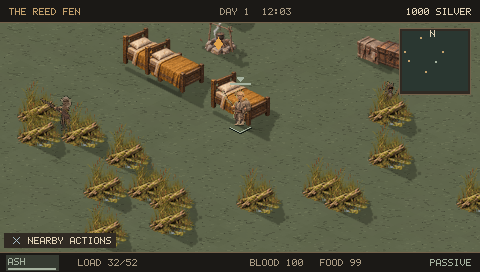

## Consequences and choices

Council actions show exact costs and influence, retain one-time pledges and relief, and resolve into ownership and price policies. The activity ledger gives discovered developments a place to be reviewed. Prosthetic previews show numerical benefits and penalties: a higher price no longer makes every lower grade obsolete.

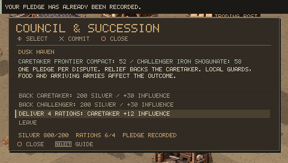
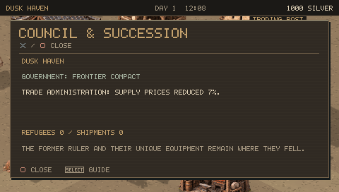
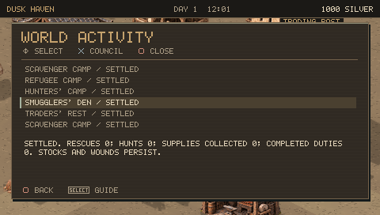
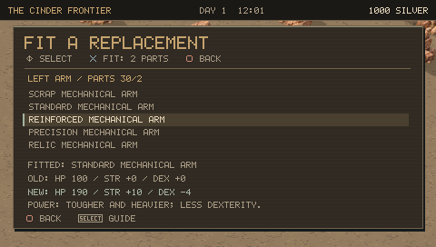
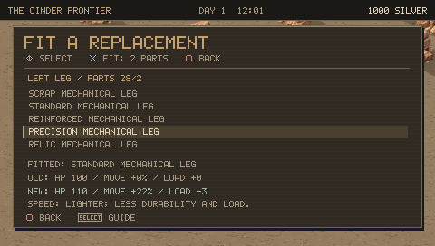

## Remaining critiques

The world now has stronger local cause and effect. Its large-scale strategy is still shallow: army missions use heuristics, off-screen combat is simplified, and local navigation can constrain routes. Political leaders use a generic surviving steward rather than a new authored character with unique dialogue and equipment. Camps reuse much of their artwork. Loot/economy pacing still needs a naturally played campaign, and physical PSP performance remains unqualified.

The extended tests found and fixed an invalid carry chain that short scenarios missed. They also exposed the need for crews to consume camp stock themselves and for hunters to finish gathering before leaving. These checks improve confidence in persistence; they do not prove that the whole campaign is balanced or that every journey will be interesting.
