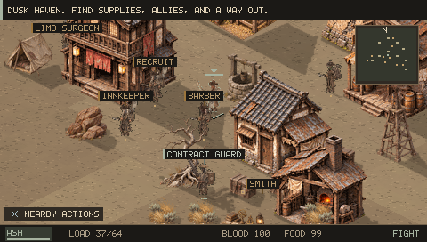
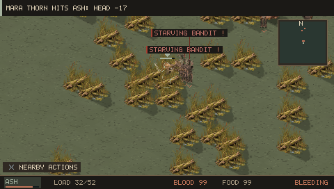
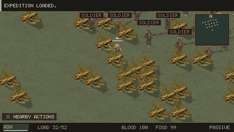
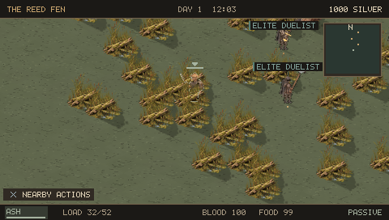
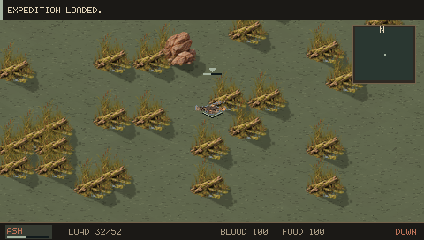
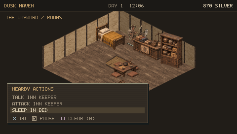
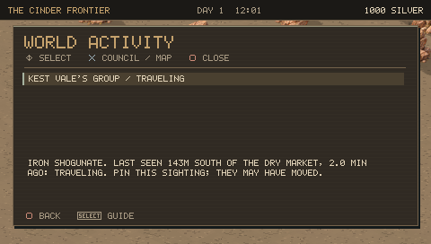
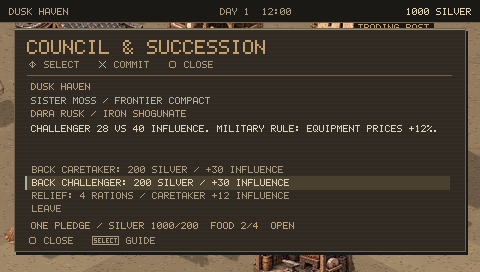
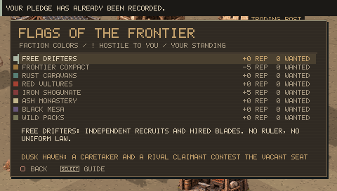

# 0.14.0 playtest findings and changes

The 0.13 playtest found an inn bed opening nearby NPC dialogue, hard-to-see fallen characters, insufficient visual distinction between threats, passive map travel, an unhelpful world counter ledger, abstract succession choices, and routine notifications competing with meaningful outcomes.

| Finding | Change verified in 0.14 |
|---|---|
| Map travel removes decisions | Automatic map and group travel removed. Pinning a destination leaves the player stationary; a fresh journey is walked with the analog stick. |
| Threat should be visible | Poor bandits have missing clothes and low-quality weapons; military units wear coordinated armor and form ranks; elite duelists wear complete superior equipment. Nearby role/faction/hostility labels contain no health or level numbers. |
| Bed selection opens dialogue | The actual old inn save reproduces the close NPC/bed setup. Choosing Sleep in bed charges 25, starts rest and heals in the PSP executable. |
| Grass hides fallen characters | A late silhouette pass preserves the pose of squad members and active combatants through foreground scenery. |
| Activity is just counters | Reports retain observed position and time, survive reload, and open a historical map location without moving the player or tracking remote groups. |
| Succession is impersonal | Distinct claimant names, selected-side influence comparison and policy preview before committing. Pledges still spend once. |
| Routine messages compete with outcomes | Successful autosaves are silent; skill gains only enter a clear feed and remain in Recent messages; contract rewards are prioritized. |

These are completed-frame captures from the PSP executable. The fresh journey starts with character creation. Rare situations use ordinary prepared saves and normal controller input; they are not claimed as naturally encountered in one full campaign.

Remaining limitations: dense fights still crowd the PSP's small screen, so labels are capped at eight and overlapping labels are skipped. Clothing detail remains small at world scale. Succession remains a compact influence model, not a full political quest system. Natural campaign pacing and difficulty need longer human playtesting; physical PSP performance has not been measured.
