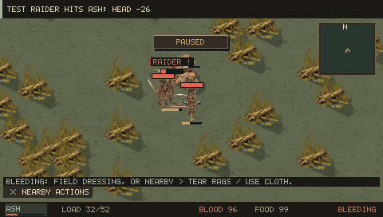
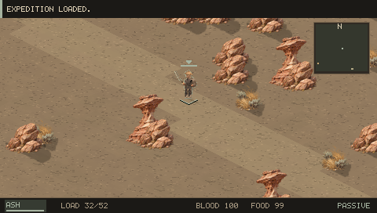
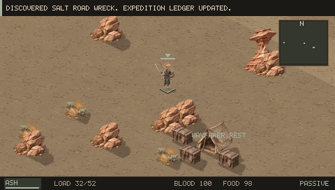
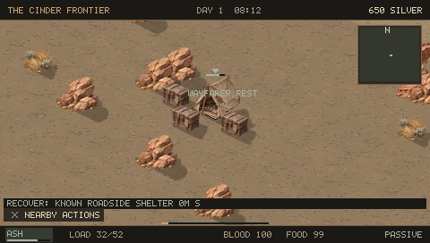
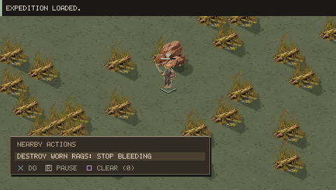
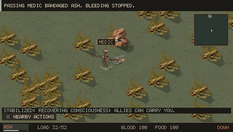
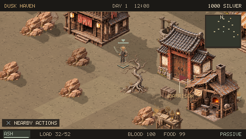
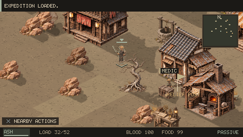

# 0.15.0 critique and verification

| Criticism | Change | Evidence |
|---|---|---|
| Crowded fights obscure the action | One focused role label, outlined knockout bars, windup/impact cues, vegetation clearing | Combat and disengagement captures |
| Equipment tiers are too subtle | Slimmer bare/ragged bodies, broader heavy armor; real equipment still controls appearance | Starving-bandit, army and elite captures; attachment/render regressions |
| Melee becomes a pile-on | Two simultaneous AI melee preparations/strikes per target, waiting attackers reposition, passive cancels your attack | Native attack-window checks; controller combat and retreat |
| Manual exploration lacks route decisions | Six rock passes with projectile cover, central lanes and bypasses, finite roadside recovery stops | Controller walk through and around a pass; projectile/collision checks |
| Political changes feel textual | Surviving guards move posts, civilians are displaced, relief medics walk to a post, visible policy banner | Native physical movement/persistence checks; occupied town and relief-post captures |
| Defeat encourages waiting or reloading | Costly emergency dressing, safe NPC assistance using real supplies, free roadside beds and recovery directions | Controller rag destruction, medic rescue, bed recovery and save/reload |

## Screenshots from the PSP executable

## Review limits

The controller run combines a fresh expedition and ordinary prepared saves so specific injuries, encounters and succession outcomes can be exercised reliably. It is not a claim of completing a natural campaign. Large battles can still become crowded; this pass improves their information hierarchy and attack timing rather than removing the danger. Six authored passes improve particular journeys rather than giving every stretch of wilderness an authored obstacle. Organic multi-hour campaign pacing and physical PSP performance still need separate evaluation.
